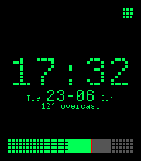
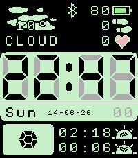

<!-- Generated by scripts/update_app_directory.py: do not edit by hand -->
[← All Pebble Developers](../developers.md)

# Baldur Thor

*2 watchfaces · Last updated 2026-10-11 · [About these lists](../about-app-lists.md)*

Links: [Pebble App Store](https://apps.repebble.com/apps/dev/baldur-thor_f78f823a876e65b57bbe3f8a) · [GitHub (BaldurThor)](https://github.com/BaldurThor)

<button type="button" data-filter="all" aria-pressed="true">All 2</button><button type="button" data-filter="watchface" aria-pressed="false">Watchfaces 2</button><button type="button" data-filter="watchapp" aria-pressed="false" disabled>Apps 0</button>

<label class="dev-sort">Sort by <select><option value="updated">Recently updated</option><option value="released">Newest release</option><option value="title">A–Z</option></select></label>

<h2 class="app-name" id="app-f02345b95a5440cd9bc253df"><a href="https://apps.repebble.com/f02345b95a5440cd9bc253df">Dots</a> v1.0.0</h2>
<a class="app-source" href="https://github.com/BaldurThor/pebble-dots" title="Source code" data-search-exclude>View source</a>

Watchface

No licence Released 2026-06-23 Updated 2026-06-23

Runs on: Time 2

A simple watchface based on dots. Shows time and date, with month and day name. Has a battery indicator, and a bt disconnect and quiet time indicator (the same one) also shows simple weather…

<h2 class="app-name" id="app-4a1f0dd1c59145fb940f76b2"><a href="https://apps.repebble.com/4a1f0dd1c59145fb940f76b2">Retro Scheme</a> v1.0.0</h2>
<a class="app-source" href="https://github.com/BaldurThor/WatchFace" title="Source code" data-search-exclude>View source</a>

Watchface

No licence Released 2026-06-14 Updated 2026-06-14

Runs on: Time 2

A retro looking watchface with weather, hr, steps, compass and more! Heavily based of Last Time by mgerb I just wanted to see how hard it was to make one

