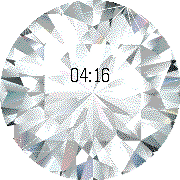

<!-- Generated by scripts/update_app_directory.py: do not edit by hand -->
[← All Pebble Developers](../developers.md)

# Bani

*1 watchface · Last updated 2026-10-11 · [About these lists](../about-app-lists.md)*

Links: [Pebble App Store](https://apps.repebble.com/apps/dev/bani_5668b28f638b2661bc000069) · [GitHub (bani)](https://github.com/bani) · [Website (weureka.com)](http://weureka.com/)

<h2 class="app-name" id="app-56931746a45b56940a000017"><a href="https://apps.repebble.com/56931746a45b56940a000017">Diamond</a> v2.1</h2>
<a class="app-source" href="https://github.com/bani/pebble-diamond" title="Source code" data-search-exclude>View source</a>

Watchface

MIT Released 2016-01-11 Updated 2016-02-14

Runs on: Round 2, Time Round

It&#x27;s time for smart jewellery. They say diamonds are a girl&#x27;s best friend, so now you can carry around this huge virtual diamond. Your Pebble Time Round will display this glorious 2cm of sparkling…

