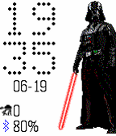

<!-- Generated by scripts/update_app_directory.py: do not edit by hand -->
[← All Pebble Developers](../developers.md)

# baranyaib90

*1 watchface · Last updated 2026-10-11 · [About these lists](../about-app-lists.md)*

Links: [Rebble App Store](https://apps.rebble.io/en_US/developer/55172d4d41e7e0844d000035/1) · [GitHub (baranyaib90)](https://github.com/baranyaib90)

<h2 class="app-name" id="app-58fb859d0dfc329fda001720"><a href="https://apps.rebble.io/en_US/application/58fb859d0dfc329fda001720">Star Wars Characters</a> v1.6</h2>
<a class="app-source" href="https://github.com/baranyaib90/pebble-sw-characters" title="Source code" data-search-exclude>View source</a>

Watchface

Unlicense Released 2017-04-22 Updated 2017-06-19 Rebble App Store

Runs on: Time 2, Pebble 2 Duo, Pebble 2, Time, Classic

Simple watchface with Star Wars characters. Current characters list: Darth Vader, Luke Skywalker with green saber, Han Solo, Luke Skywalker from episode 1, C3PO, Rey, Finn, Rey with staff…

