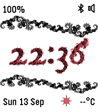

<!-- Generated by scripts/update_app_directory.py: do not edit by hand -->
[← All Pebble Developers](../developers.md)

# bart

*1 watchface · Last updated 2026-10-12 · [About these lists](../about-app-lists.md)*

Links: [Rebble App Store](https://apps.rebble.io/en_US/developer/6aa8615fc8ad1b00099cb09b/1) · [GitHub (bartp5)](https://github.com/bartp5)

<h2 class="app-name" id="app-6aa86ba0e3f5410009b75ae7"><a href="https://apps.rebble.io/en_US/application/6aa86ba0e3f5410009b75ae7">dragon</a> v1.0.0</h2>
<a class="app-source" href="https://github.com/bartp5/pebble-dragon" title="Source code" data-search-exclude>View source</a>

Watchface · <a href="https://forum.rebble.io/t/1360" title="Discuss this app on the Rebble forum" data-search-exclude>Forum thread</a>

Other Released 2026-09-14 Updated 2026-09-14 Rebble App Store

Runs on: Time 2

A watchface for the Pebble Time 2 featuring dragon curves, intricate fractal shapes obtained by iteratively folding the curve. The watchface features: - Time in decorated glyphs - Battery…

