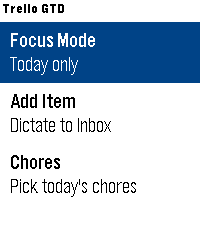
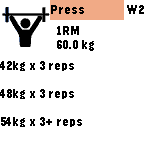

<!-- Generated by scripts/update_app_directory.py: do not edit by hand -->
[← All Pebble Developers](../developers.md)

# Bart

*3 apps · Last updated 2026-10-11 · [About these lists](../about-app-lists.md)*

Links: [Pebble App Store](https://apps.repebble.com/apps/dev/bart_677816f9a89c5300085e541a) · [Codeberg (louwers)](https://codeberg.org/louwers) · [GitHub (louwers)](https://github.com/louwers)

<button type="button" data-filter="all" aria-pressed="true">All 3</button><button type="button" data-filter="watchface" aria-pressed="false" disabled>Watchfaces 0</button><button type="button" data-filter="watchapp" aria-pressed="false">Apps 3</button>

<label class="dev-sort">Sort by <select><option value="updated">Recently updated</option><option value="released">Newest release</option><option value="title">A–Z</option></select></label>

<h2 class="app-name" id="app-beb6e05a43eb48b0a6f3f526"><a href="https://apps.repebble.com/beb6e05a43eb48b0a6f3f526">Trello GTD</a> v1.2.0</h2>
<a class="app-source" href="https://git.sr.ht/~bl/pebble-trello-gtd" title="Source code" data-search-exclude>View source</a>

App

Released 2026-07-08 Updated 2026-07-16

Runs on: Time 2

Manage a Trello GTD board from your Pebble

<h2 class="app-name" id="app-d0a1a7162b53466f9eae87cb"><a href="https://apps.repebble.com/d0a1a7162b53466f9eae87cb">Nuovo Multi Timer</a> v1.0</h2>
<a class="app-source" href="https://codeberg.org/louwers/pebble-nuovo-multi-timer" title="Source code" data-search-exclude>View source</a>

App

Released 2026-07-02 Updated 2026-07-02

Runs on: Time 2

Multi Timer is simply the best timer and stopwatch app for Pebble. It was developed by Matthew Tole in 2014. Nuovo Multi Timer is an adaption for Pebble Time 2.

<h2 class="app-name" id="app-6891dd78069d3e0009f9f825"><a href="https://apps.repebble.com/6891dd78069d3e0009f9f825">5/3/1 Training</a> v1.1</h2>
<a class="app-source" href="https://github.com/louwers/531-pebble" title="Source code" data-search-exclude>View source</a>

App

Released 2025-08-05 Updated 2025-08-05

Runs on: Time 2, Pebble 2 Duo, Pebble 2, Time, Classic

Calculates weights and sets based on Jim Wendler&#x27;s 5/3/1 barbell training program so your next lifts are always available right on your wrist.

