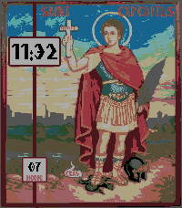

<!-- Generated by scripts/update_app_directory.py: do not edit by hand -->
[← All Pebble Developers](../developers.md)

# Bayport

*2 watchfaces · Last updated 2026-10-11 · [About these lists](../about-app-lists.md)*

Links: [Pebble App Store](https://apps.repebble.com/apps/dev/bayport_03559efbed7009e6e0cfe6de) · [GitHub (b-bayport)](https://github.com/b-bayport) · [Website (en.wikipedia.org)](https://en.wikipedia.org/wiki/Expeditus)

<button type="button" data-filter="all" aria-pressed="true">All 2</button><button type="button" data-filter="watchface" aria-pressed="false">Watchfaces 2</button><button type="button" data-filter="watchapp" aria-pressed="false" disabled>Apps 0</button>

<label class="dev-sort">Sort by <select><option value="updated">Recently updated</option><option value="released">Newest release</option><option value="title">A–Z</option></select></label>

<h2 class="app-name" id="app-7bd38b308b9d4aa0b7e8b209"><a href="https://apps.repebble.com/7bd38b308b9d4aa0b7e8b209">Saint Expeditus</a> v1.0.0</h2>
<a class="app-source" href="https://github.com/b-bayport/pebble_saint-expeditus" title="Source code" data-search-exclude>View source</a>

Watchface

No licence Released 2026-06-07 Updated 2026-06-08

Runs on: Round 2, Time 2, Pebble 2 Duo, Pebble 2, Time Round, Time, Classic

Saint Expeditus. You who are a Holy warrior. You who are the Saint of the afflicted. You who are the Saint of the desperate, you who are the Saint of urgent causes, Protect me, Help me, Give me…

<h2 class="app-name" id="app-9be723f675544505b46e5692"><a href="https://apps.repebble.com/9be723f675544505b46e5692">Captain Wednesday</a> v1.2.0</h2>
<a class="app-source" href="https://github.com/b-bayport/pebble_captnwednesday" title="Source code" data-search-exclude>View source</a>

Watchface

No licence Released 2026-05-26 Updated 2026-06-01

Runs on: Time 2

Tintin&#x27;s word bubble updates with the day of the week. Battery indicator is the beer glass level in front of Snowy, increments at 90, 60, 40%.

