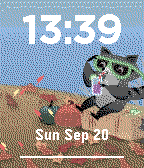
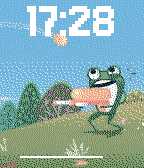

<!-- Generated by scripts/update_app_directory.py: do not edit by hand -->
[← All Pebble Developers](../developers.md)

# BD Crowell

*3 watchfaces and 1 app · Last updated 2026-10-11 · [About these lists](../about-app-lists.md)*

Links: [Pebble App Store](https://apps.repebble.com/apps/dev/bd-crowell_bc77df078bf00f8502c00039) · [GitHub (bcrowell770)](https://github.com/bcrowell770)

<button type="button" data-filter="all" aria-pressed="true">All 4</button><button type="button" data-filter="watchface" aria-pressed="false">Watchfaces 3</button><button type="button" data-filter="watchapp" aria-pressed="false">Apps 1</button>

<label class="dev-sort">Sort by <select><option value="updated">Recently updated</option><option value="released">Newest release</option><option value="title">A–Z</option></select></label>

<h2 class="app-name" id="app-5d2e86b927824a7d8c328af0"><a href="https://apps.repebble.com/5d2e86b927824a7d8c328af0">Tucson Mural</a> v1.0.0</h2>
<a class="app-source" href="https://github.com/bcrowell770/Tucson-Mural" title="Source code" data-search-exclude>View source</a>

Watchface

No licence Released 2026-10-10 Updated 2026-10-10

Runs on: Round 2, Time 2, Time

The time itself is the mural. Tucson Mural fills bold, readable numerals with original Sonoran Desert illustrations: Catalina Mountains, saguaros, prickly pear, wildflowers, desert wildlife, and…

<h2 class="app-name" id="app-d343af2118ad469280a94611"><a href="https://apps.repebble.com/d343af2118ad469280a94611">Cozy Seasons Light</a> v1.1.0</h2>
<a class="app-source" href="https://github.com/bcrowell770/Cozy-Seasons-Light" title="Source code" data-search-exclude>View source</a>

Watchface

MIT Released 2026-09-20 Updated 2026-09-20

Runs on: Time 2, Time

A little seasonal comfort, in a smaller download. Cozy Seasons Light brings changing scenery and gentle seasonal animations to your wrist. Enjoy 48 backgrounds across spring, summer, autumn, and…

<h2 class="app-name" id="app-a4ccbbb5597a43fda1bf1209"><a href="https://apps.repebble.com/a4ccbbb5597a43fda1bf1209">Cozy Seasons</a> v1.4.0</h2>
<a class="app-source" href="https://github.com/bcrowell770/Cozy-Seasons" title="Source code" data-search-exclude>View source</a>

Watchface

MIT Released 2026-04-08 Updated 2026-09-19

Runs on: Time 2, Time

Enjoy a cozy view of the changing seasons right on your wrist. Cozy Seasons pairs clean, readable time with dynamic seasonal backgrounds that bring each season to life — without clutter or…

<h2 class="app-name" id="app-69cbba0e4fec4ab29374da39"><a href="https://apps.repebble.com/69cbba0e4fec4ab29374da39">AirCheck</a> v1.3.2</h2>
<a class="app-source" href="https://github.com/bcrowell770/AirCheck" title="Source code" data-search-exclude>View source</a>

App

MIT Released 2026-04-12 Updated 2026-07-24

Runs on: Round 2, Time 2, Pebble 2 Duo, Pebble 2, Time Round, Time, Classic

AirCheck gives you a fast, simple answer to one question: should you go outside right now? Using real-time air quality (AQI) and weather data, AirCheck gives you a simple, instant recommendation…

