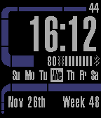

<!-- Generated by scripts/update_app_directory.py: do not edit by hand -->
[← All Pebble Developers](../developers.md)

# Beecon

*1 watchface · Last updated 2026-10-11 · [About these lists](../about-app-lists.md)*

Links: [Rebble App Store](https://apps.rebble.io/en_US/developer/692767cb1726d100087c26c0/1) · [GitHub (nbeeson2)](https://github.com/nbeeson2) · [Website (bsky.app)](https://bsky.app/profile/pretty-wizard.bsky.social)

<h2 class="app-name" id="app-69278a5b02745c00096070b9"><a href="https://apps.rebble.io/en_US/application/69278a5b02745c00096070b9">Trekv3 with Updated Weather</a> v6.0</h2>
<a class="app-source" href="https://github.com/nbeeson2/pebbleface-trekv3_5.0/tree/master" title="Source code" data-search-exclude>View source</a>

Watchface

Released 2025-11-26 Updated 2025-11-26 Rebble App Store

Runs on: Round 2, Time 2, Pebble 2 Duo, Pebble 2, Time Round, Time, Classic

This is an updated version of Chops&#x27; Trekv3 watchface: https://apps.rebble.io/en_US/application/555c1924ac15b6f992000076 This updated fork fixes the weather API which broke when Yahoo shut it…

