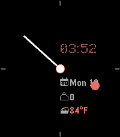

<!-- Generated by scripts/update_app_directory.py: do not edit by hand -->
[← All Pebble Developers](../developers.md)

# beefeeny

*1 watchface · Last updated 2026-10-11 · [About these lists](../about-app-lists.md)*

Links: [Pebble App Store](https://apps.repebble.com/apps/dev/beefeeny_4504ad62cdf726c016180eae) · [GitHub (Jeevus3D)](https://github.com/Jeevus3D)

<h2 class="app-name" id="app-4fcddcfe77784c2f87302d40"><a href="https://apps.repebble.com/4fcddcfe77784c2f87302d40">CMF Analog - PT2</a> v1.0</h2>
<a class="app-source" href="https://github.com/Jeevus3D/CMF-Analog-Pebble-Watch-Face" title="Source code" data-search-exclude>View source</a>

Watchface

No licence Released 2026-04-13 Updated 2026-04-13

Runs on: Round 2, Time 2, Pebble 2 Duo, Pebble 2, Time Round, Time, Classic

My personal favorite daily driver watch face. Styled after the Nothing CMF Analog face. Complications for date, steps, and local weather. Designed for the PT2 and PR2, may work with other, earlier…

