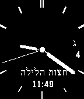

<!-- Generated by scripts/update_app_directory.py: do not edit by hand -->
[← All Pebble Developers](../developers.md)

# Beezy Works Studios

*1 watchface · Last updated 2026-10-12 · [About these lists](../about-app-lists.md)*

Links: [Pebble App Store](https://apps.repebble.com/apps/dev/beezy-works-studios_54a02306a5a51914a3000114) · [GitHub (BeezyWorks)](https://github.com/BeezyWorks)

<h2 class="app-name" id="app-57f3f1953c754a887a0000a9"><a href="https://apps.repebble.com/57f3f1953c754a887a0000a9">Analog Zmanim</a> v1.5</h2>
<a class="app-source" href="https://github.com/BeezyWorks/pebble_zman" title="Source code" data-search-exclude>View source</a>

Watchface

GPL-3.0 Released 2016-10-04 Updated 2017-01-26

Runs on: Round 2, Time 2, Pebble 2 Duo, Pebble 2, Time Round, Time, Classic

Simple analog watchface with Hebrew and Gregorian date that displays upcoming zmanim. Zmanim are calculated on the watch itself and do not require an internet connection. Zmanim are accurate +- 2…

