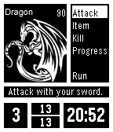

<!-- Generated by scripts/update_app_directory.py: do not edit by hand -->
[← All Pebble Developers](../developers.md)

# Belphemur

*1 watchface and 1 app · Last updated 2026-10-11 · [About these lists](../about-app-lists.md)*

Links: [Pebble App Store](https://apps.repebble.com/apps/dev/belphemur_529a46ed129af768b50000ea) · [GitHub (Belphemur)](https://github.com/Belphemur) · [Website (aaflalo.me)](http://aaflalo.me/portfolio/minidungeon-ex/)

<button type="button" data-filter="all" aria-pressed="true">All 2</button><button type="button" data-filter="watchface" aria-pressed="false">Watchfaces 1</button><button type="button" data-filter="watchapp" aria-pressed="false">Apps 1</button>

<label class="dev-sort">Sort by <select><option value="updated">Recently updated</option><option value="released">Newest release</option><option value="title">A–Z</option></select></label>

<h2 class="app-name" id="app-52a8c1702438eb042600000b"><a href="https://apps.repebble.com/52a8c1702438eb042600000b">MiniDungeon EX</a> v5.4</h2>
<a class="app-source" href="https://github.com/Belphemur/MiniDungeon" title="Source code" data-search-exclude>View source</a>

App

No licence Released 2013-12-11 Updated 2015-07-09

Runs on: Time 2, Pebble 2 Duo, Pebble 2, Time, Classic

MiniDungeon Extended is a small adventure game on your watch. The goal is to survive to the 20th floor of the dungeon and defeat the final monster there. In order to aid you with this task, you…

<h2 class="app-name" id="app-52a634d79f74c6cb3c00000c"><a href="https://apps.repebble.com/52a634d79f74c6cb3c00000c">Fuzzy Time + v3</a> v2.6.0</h2>
<a class="app-source" href="https://github.com/Belphemur/fuzzy_time_plus_v2" title="Source code" data-search-exclude>View source</a>

Watchface

No licence Released 2013-12-09 Updated 2014-01-11

Runs on: Time 2, Pebble 2 Duo, Pebble 2, Time, Classic

Inspired by Pebble&#x27;s Fuzzy Time. Included a top bar to display the day and date and a bottom bar to display the 24 hour time and the day of the year. Updated version of the original Fuzzy Time +…

