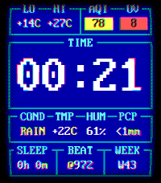

<!-- Generated by scripts/update_app_directory.py: do not edit by hand -->
[← All Pebble Developers](../developers.md)

# bemyak

*1 watchface · Last updated 2026-10-26 · [About these lists](../about-app-lists.md)*

Links: [Pebble App Store](https://apps.repebble.com/apps/dev/bemyak_9256eb89addd27c58ee5b339) · [GitHub (bemyak)](https://github.com/bemyak) · [Website (blog.bemyak.net)](https://blog.bemyak.net)

<h2 class="app-name" id="app-d19443a35c6240ccaca492f5"><a href="https://apps.repebble.com/d19443a35c6240ccaca492f5">Nostalgic Commander</a> v1.12.0</h2>
<a class="app-source" href="https://github.com/bemyak/nostalgic_commander" title="Source code" data-search-exclude>View source</a>

Watchface · <a href="https://forum.rebble.io/t/1198" title="Discuss this app on the Rebble forum" data-search-exclude>Forum thread</a>

Other Released 2026-08-01 Updated 2026-10-25

Runs on: Time 2

What if a Pebble Time 2 watchface was designed in 1992? Could it be not only beautiful, but customizable, functional and performant? Just perfect for everyday use! Feast your eyes on five glorious…

