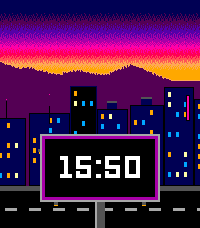
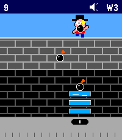
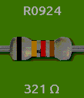

<!-- Generated by scripts/update_app_directory.py: do not edit by hand -->
[← All Pebble Developers](../developers.md)

# Ben Combee (@unwiredben)

*3 watchfaces and 1 app · Last updated 2026-10-11 · [About these lists](../about-app-lists.md)*

Links: [Pebble App Store](https://apps.repebble.com/apps/dev/ben-combee-unwiredben_551338e88630986002000039) · [GitHub (unwiredben)](https://github.com/unwiredben) · [Website (combee.net)](https://www.combee.net/)

<button type="button" data-filter="all" aria-pressed="true">All 4</button><button type="button" data-filter="watchface" aria-pressed="false">Watchfaces 3</button><button type="button" data-filter="watchapp" aria-pressed="false">Apps 1</button>

<label class="dev-sort">Sort by <select><option value="updated">Recently updated</option><option value="released">Newest release</option><option value="title">A–Z</option></select></label>

<h2 class="app-name" id="app-5956db8bf1aa4474af893ed3"><a href="https://apps.repebble.com/5956db8bf1aa4474af893ed3">Oregon Ho!</a> v1.3.0</h2>
<a class="app-source" href="https://github.com/unwiredben/oregon-ho-for-pebble" title="Source code" data-search-exclude>View source</a>

Watchface · <a href="https://forum.rebble.io/t/1394" title="Discuss this app on the Rebble forum" data-search-exclude>Forum thread</a>

Released 2026-10-01 Updated 2026-10-08

Runs on: Round 2, Time 2, Time Round, Time

Inspired by Oregon Trail, watch your wagon move across the US while your party encounters windfalls and trails.

<h2 class="app-name" id="app-08dcdb573df44de99a9978ed"><a href="https://apps.repebble.com/08dcdb573df44de99a9978ed">Streaming Village</a> v1.3.0</h2>
<a class="app-source" href="https://github.com/unwiredben/streamingvillage-for-pebble" title="Source code" data-search-exclude>View source</a>

Watchface · <a href="https://forum.rebble.io/t/1347" title="Discuss this app on the Rebble forum" data-search-exclude>Forum thread</a>

Released 2026-09-09 Updated 2026-09-18

Runs on: Round 2, Time 2, Time Round, Time

It&#x27;s a parallax-scrolling purple-tinged city rolling by on your wrist, with billboards showing the time passing by in the foreground. Adjusts for 12 or 24-hour time display preferences, handles…

<h2 class="app-name" id="app-1e6c5bbde96f4e6ca3497194"><a href="https://apps.repebble.com/1e6c5bbde96f4e6ca3497194">Kablooey!</a> v1.1.0</h2>
<a class="app-source" href="https://github.com/unwiredben/kablooey-for-pebble" title="Source code" data-search-exclude>View source</a>

App · <a href="https://forum.rebble.io/t/1368" title="Discuss this app on the Rebble forum" data-search-exclude>Forum thread</a>

Released 2026-09-18 Updated 2026-09-18

Runs on: Time 2

Scarry Kablam is at it again, and you and your bucket brigade are what stands in the way of devastation. Use your touch-enabled Pebble Time 2 to catch the bombs before they hit the bottom of the…

<h2 class="app-name" id="app-55561ff444dad6e1470000df"><a href="https://apps.repebble.com/55561ff444dad6e1470000df">Resistor Time</a> v2.3</h2>
<a class="app-source" href="https://github.com/unwiredben/resistor-time" title="Source code" data-search-exclude>View source</a>

Watchface

Released 2015-05-15 Updated 2020-05-23

Runs on: Round 2, Time 2, Time Round, Time

Are you an electrical engineer or a electronics hobbyist? Need some training in recognizing resistor color codes? Resistor Time is the answer, showing the current time and date via the magic of…

