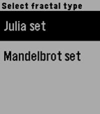

<!-- Generated by scripts/update_app_directory.py: do not edit by hand -->
[← All Pebble Developers](../developers.md)

# Ben

*1 app · Last updated 2026-10-11 · [About these lists](../about-app-lists.md)*

Links: [Rebble App Store](https://apps.rebble.io/en_US/developer/585ffd9e0e3a49dd2600003f/1) · [GitHub (computergeek314)](https://github.com/computergeek314)

<h2 class="app-name" id="app-586bf8f7e09e63b4c7000473"><a href="https://apps.rebble.io/en_US/application/586bf8f7e09e63b4c7000473">MandaFractal</a> v1.0</h2>
<a class="app-source" href="https://github.com/computergeek314/PebbleFractal/blob/master/main.c" title="Source code" data-search-exclude>View source</a>

App

Released 2017-01-03 Updated 2017-01-05 Rebble App Store

Runs on: Round 2, Time 2, Pebble 2 Duo, Pebble 2, Time Round, Time, Classic

Generate colorful fractals on the fly with this watchapp. Capable of rendering Julia and Mandelbrot sets quickly and zooming and panning within them. NOTE: On non color screens, the parts that…

