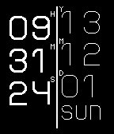

<!-- Generated by scripts/update_app_directory.py: do not edit by hand -->
[← All Pebble Developers](../developers.md)

# Ben Froman

*1 watchface · Last updated 2026-10-11 · [About these lists](../about-app-lists.md)*

Links: [Pebble App Store](https://apps.repebble.com/apps/dev/ben-froman_529befccf33e769ff3000007) · [GitHub (Dwarf84396)](https://github.com/Dwarf84396)

<h2 class="app-name" id="app-529bf118f33e7653f000000b"><a href="https://apps.repebble.com/529bf118f33e7653f000000b">Side By Side</a> v1.0.0</h2>
<a class="app-source" href="https://github.com/Dwarf84396/side_by_side" title="Source code" data-search-exclude>View source</a>

Watchface

No licence Released 2013-12-02 Updated 2013-12-02

Runs on: Time 2, Pebble 2 Duo, Pebble 2, Time, Classic

A simple vertical watch face, displaying both time and date.

