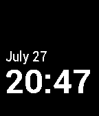

<!-- Generated by scripts/update_app_directory.py: do not edit by hand -->
[← All Pebble Developers](../developers.md)

# Ben Galbraith

*1 app · Last updated 2026-10-12 · [About these lists](../about-app-lists.md)*

Links: [Pebble App Store](https://apps.repebble.com/apps/dev/ben-galbraith_538927eef63efc4475000043) · [GitHub (bgalbs)](https://github.com/bgalbs) · [Website (medium.com)](https://medium.com/ben-and-dion/feeling-time-378e44e31ee0)

<h2 class="app-name" id="app-55af3b34f52274489e000037"><a href="https://apps.repebble.com/55af3b34f52274489e000037">Time Helper</a> v1.0</h2>
<a class="app-source" href="https://github.com/bgalbs/time-helper" title="Source code" data-search-exclude>View source</a>

App

MIT Released 2015-07-22 Updated 2015-07-22

Runs on: Time 2, Pebble 2 Duo, Pebble 2, Time, Classic

Time Helper is an app for telling time through vibrations. When run, Time Helper appears to be one of the Pebble&#x27;s watchfaces. However, unlike a standard watchface, the app will vibrate distinctly…

