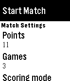
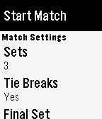

<!-- Generated by scripts/update_app_directory.py: do not edit by hand -->
[← All Pebble Developers](../developers.md)

# Ben Gourley

*2 apps · Last updated 2026-10-11 · [About these lists](../about-app-lists.md)*

Links: [Pebble App Store](https://apps.repebble.com/apps/dev/ben-gourley_568aaba9b54aa7a22d000014) · [GitHub (bengourley)](https://github.com/bengourley)

<button type="button" data-filter="all" aria-pressed="true">All 2</button><button type="button" data-filter="watchface" aria-pressed="false" disabled>Watchfaces 0</button><button type="button" data-filter="watchapp" aria-pressed="false">Apps 2</button>

<label class="dev-sort">Sort by <select><option value="updated">Recently updated</option><option value="released">Newest release</option><option value="title">A–Z</option></select></label>

<h2 class="app-name" id="app-5754480670c28cee0e00000a"><a href="https://apps.repebble.com/5754480670c28cee0e00000a">Squash</a> v0.1</h2>
<a class="app-source" href="https://github.com/bengourley/pebble-squash" title="Source code" data-search-exclude>View source</a>

App

BSD-3-Clause Released 2016-06-05 Updated 2016-06-05

Runs on: Time 2, Pebble 2 Duo, Pebble 2, Time, Classic

Keep track of the score in your squash matches with simple controls and a clean, uncluttered interface. This is the squash version of my Tennis score keeper app. Match formats are easily…

<h2 class="app-name" id="app-572a8209381261f35e00000a"><a href="https://apps.repebble.com/572a8209381261f35e00000a">Tennis</a> v0.5</h2>
<a class="app-source" href="https://github.com/bengourley/pebble-tennis" title="Source code" data-search-exclude>View source</a>

App

BSD-3-Clause Released 2016-05-04 Updated 2016-05-26

Runs on: Time 2, Pebble 2 Duo, Pebble 2, Time, Classic

Built by a tennis player for tennis players. Keep track of the score in your tennis matches with simple controls and a clean, uncluttered interface. Match formats are easily configured inside the…

