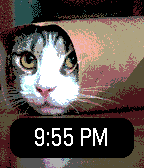
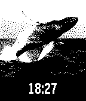

<!-- Generated by scripts/update_app_directory.py: do not edit by hand -->
[← All Pebble Developers](../developers.md)

# Ben Hudson

*2 watchfaces and 1 app · Last updated 2026-10-12 · [About these lists](../about-app-lists.md)*

Links: [Pebble App Store](https://apps.repebble.com/apps/dev/ben-hudson_5321a477c854ef9df40000d2) · [GitHub (ben-hudson)](https://github.com/ben-hudson)

<button type="button" data-filter="all" aria-pressed="true">All 3</button><button type="button" data-filter="watchface" aria-pressed="false">Watchfaces 2</button><button type="button" data-filter="watchapp" aria-pressed="false">Apps 1</button>

<label class="dev-sort">Sort by <select><option value="updated">Recently updated</option><option value="released">Newest release</option><option value="title">A–Z</option></select></label>

<h2 class="app-name" id="app-544b0614d68d8f3a9b000029"><a href="https://apps.repebble.com/544b0614d68d8f3a9b000029">Purrbble</a> v2.0</h2>
<a class="app-source" href="https://github.com/ben-hudson/purrbble" title="Source code" data-search-exclude>View source</a>

Watchface

No licence Released 2014-10-25 Updated 2015-11-04

Runs on: Time 2, Time

Cats. Every time you flick your wrist.

<h2 class="app-name" id="app-54558ae17871923078000014"><a href="https://apps.repebble.com/54558ae17871923078000014">Defaced</a> v1.1</h2>
<a class="app-source" href="https://github.com/ben-hudson/defaced" title="Source code" data-search-exclude>View source</a>

Watchface

No licence Released 2014-11-02 Updated 2014-11-22

Runs on: Time 2, Pebble 2 Duo, Pebble 2, Time, Classic

An infinitely customizable watchface.

<h2 class="app-name" id="app-546eb7115c3354a16700004d"><a href="https://apps.repebble.com/546eb7115c3354a16700004d">Boing Ball</a> v1.0</h2>
<a class="app-source" href="https://bitbucket.org/ben-hudson/boing-ball" title="Source code" data-search-exclude>View source</a>

App

Released 2014-11-21 Updated 2014-11-21

Runs on: Time 2, Pebble 2 Duo, Pebble 2, Time, Classic

The iconic Amiga Boing Ball, on your wrist. Built on the minimal OpenGL 1.1 engine from PebbleGL 3D.

