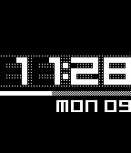
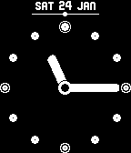

<!-- Generated by scripts/update_app_directory.py: do not edit by hand -->
[← All Pebble Developers](../developers.md)

# Ben Nguyen

*5 watchfaces · Last updated 2026-10-11 · [About these lists](../about-app-lists.md)*

Links: [Pebble App Store](https://apps.repebble.com/apps/dev/ben-nguyen_5481875759fcc2e9ef000148) · [GitHub (zecoj)](https://github.com/zecoj)

<button type="button" data-filter="all" aria-pressed="true">All 5</button><button type="button" data-filter="watchface" aria-pressed="false">Watchfaces 5</button><button type="button" data-filter="watchapp" aria-pressed="false" disabled>Apps 0</button>

<label class="dev-sort">Sort by <select><option value="updated">Recently updated</option><option value="released">Newest release</option><option value="title">A–Z</option></select></label>

<h2 class="app-name" id="app-5485a551075d4c0154000072"><a href="https://apps.repebble.com/5485a551075d4c0154000072">Ultimate Text Watch</a> v2.4</h2>
<a class="app-source" href="https://github.com/zecoj/ultimate.text.watch" title="Source code" data-search-exclude>View source</a>

Watchface

Released 2014-12-08 Updated 2016-01-09

Runs on: Time 2, Pebble 2 Duo, Pebble 2, Time, Classic

★New Name New Feature★Tell times in plain English in many ways★ Like it? Heart it! features: - tells time in plain English multiple ways: + fuzzy (ex. 12:44 = quarter to one) + human (ex. 12:44 =…

<h2 class="app-name" id="app-54a23f3785047c66b6000054"><a href="https://apps.repebble.com/54a23f3785047c66b6000054">Arsenal FC</a> v1.7</h2>
<a class="app-source" href="https://github.com/zecoj/arsenal.fc/" title="Source code" data-search-exclude>View source</a>

Watchface

Released 2014-12-30 Updated 2015-06-20

Runs on: Time 2, Pebble 2 Duo, Pebble 2, Time, Classic

★Weather+Bluetooth+Configuration+Colour★ For all gooners. Shake to show extra information (time, date &amp; battery)

<h2 class="app-name" id="app-54d802535e8d871a66000025"><a href="https://apps.repebble.com/54d802535e8d871a66000025">dots n squares</a> v1.5</h2>
<a class="app-source" href="https://github.com/zecoj/dots-n-squares" title="Source code" data-search-exclude>View source</a>

Watchface

Released 2015-02-09 Updated 2015-04-19

Runs on: Time 2, Pebble 2 Duo, Pebble 2, Time, Classic

&quot;Hand-dotted&quot; with love. Features: - Simple and elegant digital display (invertable). - Battery bar! See remaining battery at a glance. - Day of week and date. - Bluetooth connection warning. …

<h2 class="app-name" id="app-54c3925876a15567d2000012"><a href="https://apps.repebble.com/54c3925876a15567d2000012">Zen Dotz</a> v1.1</h2>
<a class="app-source" href="https://github.com/zecoj/zen.dotz" title="Source code" data-search-exclude>View source</a>

Watchface

Released 2015-01-24 Updated 2015-01-24

Runs on: Time 2, Pebble 2 Duo, Pebble 2, Time, Classic

Simple &amp; subtle analogue watch with bold hands and dots. Aimed to be easy to see at a quick glance. Features: - Month &amp; date - Battery slider (dot moves from right to left, shows remaining…

<h2 class="app-name" id="app-54a90952ae94cff8c600003f"><a href="https://apps.repebble.com/54a90952ae94cff8c600003f">digitZ</a> v1.3</h2>
<a class="app-source" href="https://github.com/zecoj/digitZ" title="Source code" data-search-exclude>View source</a>

Watchface

Released 2015-01-04 Updated 2015-01-06

Runs on: Time 2, Pebble 2 Duo, Pebble 2, Time, Classic

An improved clone of the famous DIGITTMM (by Albert Salamon) Improvements: - Much better memory usage (I have redrawn &amp; created ttf from scratch) - Shake to show battery, bluetooth connectivity…

