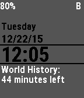

<!-- Generated by scripts/update_app_directory.py: do not edit by hand -->
[← All Pebble Developers](../developers.md)

# Ben624

*1 watchface · Last updated 2026-10-12 · [About these lists](../about-app-lists.md)*

Links: [Pebble App Store](https://apps.repebble.com/apps/dev/ben624_52d175a22fb695644200003d) · [GitHub (Ben624)](https://github.com/Ben624) · [Website (ben624.com)](http://www.ben624.com/SchoolTime/)

<h2 class="app-name" id="app-52f5396da991ccfb8b0009e4"><a href="https://apps.repebble.com/52f5396da991ccfb8b0009e4">School Time</a> v6.1</h2>
<a class="app-source" href="https://github.com/Ben624/SchoolTime" title="Source code" data-search-exclude>View source</a>

Watchface

No licence Released 2014-02-07 Updated 2015-12-21

Runs on: Round 2, Time 2, Pebble 2 Duo, Pebble 2, Time Round, Time, Classic

SchoolTime allows you to see the time left in each period. The configuration page allows you to change: - Class Names - Background Color - Bluetooth/Battery Visibility - Toggle Bluetooth Alarm…

