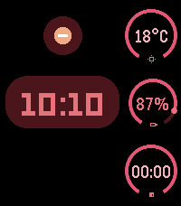
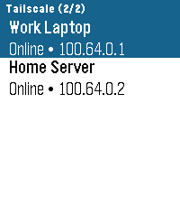
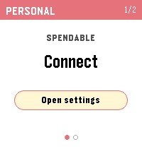

<!-- Generated by scripts/update_app_directory.py: do not edit by hand -->
[← All Pebble Developers](../developers.md)

# BenBJD

*1 watchface and 2 apps · Last updated 2026-11-16 · [About these lists](../about-app-lists.md)*

Links: [Pebble App Store](https://apps.repebble.com/apps/dev/benbjd_2957a8556836bdb2c0ebacd9) · [GitHub (BenBJD)](https://github.com/BenBJD)

<button type="button" data-filter="all" aria-pressed="true">All 3</button><button type="button" data-filter="watchface" aria-pressed="false">Watchfaces 1</button><button type="button" data-filter="watchapp" aria-pressed="false">Apps 2</button>

<label class="dev-sort">Sort by <select><option value="updated">Recently updated</option><option value="released">Newest release</option><option value="title">A–Z</option></select></label>

<h2 class="app-name" id="app-faa59b5fd2914e15aadf9162"><a href="https://apps.repebble.com/faa59b5fd2914e15aadf9162">Vector Active</a> v1.0.0</h2>
<a class="app-source" href="https://github.com/BenBJD/vector-active" title="Source code" data-search-exclude>View source</a>

Watchface

No licence Released 2026-11-12 Updated 2026-11-12

Runs on: Round 2, Time 2, Time Round, Time

A watchface inspired by the Pixel Watch &quot;Active&quot; face. Intended for round watches.

<h2 class="app-name" id="app-4005de30837e4747bf30e186"><a href="https://apps.repebble.com/4005de30837e4747bf30e186">Tailscale</a> v1.0.0</h2>
<a class="app-source" href="https://github.com/BenBJD/tailscale-pebble" title="Source code" data-search-exclude>View source</a>

App

No licence Released 2026-11-12 Updated 2026-11-12

Runs on: Round 2, Time 2, Pebble 2 Duo, Pebble 2, Time Round, Time, Classic

Simple tailscale app for viewing stats. Requires my Tailscale plugin (make sure the new plugin support is enabled)

<h2 class="app-name" id="app-818e20c1d8ce4adcb5590c5e"><a href="https://apps.repebble.com/818e20c1d8ce4adcb5590c5e">Monzo</a> v1.2.0</h2>
<a class="app-source" href="https://github.com/BenBJD/monzo-pebble" title="Source code" data-search-exclude>View source</a>

App

No licence Released 2026-11-11 Updated 2026-11-12

Runs on: Round 2, Time 2, Pebble 2 Duo, Pebble 2, Time Round, Time, Classic

Plugin and app for Monzo bank accounts

