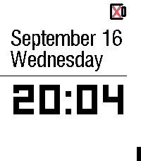
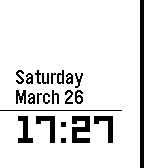

<!-- Generated by scripts/update_app_directory.py: do not edit by hand -->
[← All Pebble Developers](../developers.md)

# Benjamin Burgy

*2 watchfaces · Last updated 2026-10-11 · [About these lists](../about-app-lists.md)*

Links: [Pebble App Store](https://apps.repebble.com/apps/dev/benjamin-burgy_569540ccc3d5eb67e2000070) · [Rebble App Store](https://apps.rebble.io/en_US/developer/569540ccc3d5eb67e2000070/1) · [GitHub (bburgy)](https://github.com/bburgy) · [GitHub (minidfx)](https://github.com/minidfx)

<button type="button" data-filter="all" aria-pressed="true">All 2</button><button type="button" data-filter="watchface" aria-pressed="false">Watchfaces 2</button><button type="button" data-filter="watchapp" aria-pressed="false" disabled>Apps 0</button>

<label class="dev-sort">Sort by <select><option value="updated">Recently updated</option><option value="released">Newest release</option><option value="title">A–Z</option></select></label>

<h2 class="app-name" id="app-8270e9a5faa948f098cb253a"><a href="https://apps.repebble.com/8270e9a5faa948f098cb253a">Void Clock</a> v1.0.5</h2>
<a class="app-source" href="https://github.com/bburgy/void-clock" title="Source code" data-search-exclude>View source</a>

Watchface

MIT Released 2026-06-03 Updated 2026-09-18

Runs on: Time 2

Born from the legacy of ClockLight (a decade in the making), Void Clock is a high-contrast minimalist watchface designed for the focused. It strips away the noise to display only what matters: the…

<h2 class="app-name" id="app-56f6b6f614325b254b000053"><a href="https://apps.rebble.io/en_US/application/56f6b6f614325b254b000053">ClockLight</a> v2.1</h2>
<a class="app-source" href="https://github.com/minidfx/ClockLight" title="Source code" data-search-exclude>View source</a>

Watchface

Released 2016-03-26 Updated 2016-10-11 Rebble App Store

Runs on: Time 2, Pebble 2 Duo, Pebble 2, Time, Classic

A simple watchface displaying date, time, the day of week, the battery level and the bluetooth status with your phone when your are disconnected.

