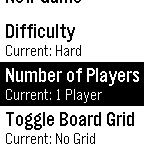
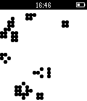

<!-- Generated by scripts/update_app_directory.py: do not edit by hand -->
[← All Pebble Developers](../developers.md)

# Benjamin Johns

*2 apps · Last updated 2026-10-11 · [About these lists](../about-app-lists.md)*

Links: [Pebble App Store](https://apps.repebble.com/apps/dev/benjamin-johns_531a426deb7a777c2000055f) · [GitHub (theoreticalb)](https://github.com/theoreticalb) · [Website (legendofben.com)](http://www.legendofben.com)

<button type="button" data-filter="all" aria-pressed="true">All 2</button><button type="button" data-filter="watchface" aria-pressed="false" disabled>Watchfaces 0</button><button type="button" data-filter="watchapp" aria-pressed="false">Apps 2</button>

<label class="dev-sort">Sort by <select><option value="updated">Recently updated</option><option value="released">Newest release</option><option value="title">A–Z</option></select></label>

<h2 class="app-name" id="app-548fcfb2cd117d43a9000084"><a href="https://apps.repebble.com/548fcfb2cd117d43a9000084">Tiny Reversi</a> v1.3</h2>
<a class="app-source" href="https://github.com/theoreticalb/pebble_reversi" title="Source code" data-search-exclude>View source</a>

App

Released 2014-12-16 Updated 2015-06-09

Runs on: Time 2, Pebble 2 Duo, Pebble 2, Time, Classic

The perfectly Pebble-sized strategy game has arrived. Reversi, marketed in the US as Othello and in Hong Kong as Apple Chess, is the classic game of surrounding tiles, flipping fortunes, and…

<h2 class="app-name" id="app-5481037659fcc2ab1b0000cb"><a href="https://apps.repebble.com/5481037659fcc2ab1b0000cb">Tiny Life</a> v1.1</h2>
<a class="app-source" href="https://github.com/theoreticalb/pebble_life" title="Source code" data-search-exclude>View source</a>

App

Released 2014-12-05 Updated 2014-12-05

Runs on: Time 2, Pebble 2 Duo, Pebble 2, Time, Classic

Tiny Life is an implementation of the zero-player classic Conway&#x27;s Game of Life for the Pebble smartwatch. Choose from multiple cell sizes and generation speeds. Get your daily cellular automata…

