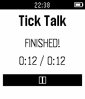

<!-- Generated by scripts/update_app_directory.py: do not edit by hand -->
[← All Pebble Developers](../developers.md)

# Benjamin von Deschwanden

*1 app · Last updated 2026-10-11 · [About these lists](../about-app-lists.md)*

Links: [Pebble App Store](https://apps.repebble.com/apps/dev/benjamin-von-deschwanden_52f5e053bd48944a170001b2) · [GitHub (vdeschwb)](https://github.com/vdeschwb)

<h2 class="app-name" id="app-563e5b2e0023547b7f00006f"><a href="https://apps.repebble.com/563e5b2e0023547b7f00006f">Tick Talk</a> v1.2</h2>
<a class="app-source" href="https://github.com/vdeschwb/Tick-Talk" title="Source code" data-search-exclude>View source</a>

App

Released 2015-11-07 Updated 2015-11-10

Runs on: Round 2, Time 2, Pebble 2 Duo, Pebble 2, Time Round, Time, Classic

This application for the Pebble smartwatch allows you to prepare perfectly for precisely timed presentations. The application lets you record and play back timing intervals for each slide of your…

