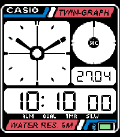

<!-- Generated by scripts/update_app_directory.py: do not edit by hand -->
[← All Pebble Developers](../developers.md)

# Bennett H

*1 watchface · Last updated 2026-10-12 · [About these lists](../about-app-lists.md)*

Links: [Pebble App Store](https://apps.repebble.com/apps/dev/bennett-h_c59f1585d97607e74a71c3b0) · [GitHub (bennetthermanoff)](https://github.com/bennetthermanoff)

<h2 class="app-name" id="app-4e33ec49ff854bb7b9093444"><a href="https://apps.repebble.com/4e33ec49ff854bb7b9093444">Casio AE-20W</a> v3.2.0</h2>
<a class="app-source" href="https://github.com/bennetthermanoff/Pebble-Casio-AE-20W" title="Source code" data-search-exclude>View source</a>

Watchface

No licence Released 2026-04-28 Updated 2026-08-06

Runs on: Time 2

This is a fork of the original by PanicMan (https://github.com/PanicMan/Pebble-Casio-AE-20W) for PT2. Fonts/Dials are new, but the background is just upscaled. If you are good at pixel art and…

