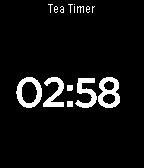

<!-- Generated by scripts/update_app_directory.py: do not edit by hand -->
[← All Pebble Developers](../developers.md)

# bennett

*1 app · Last updated 2026-10-12 · [About these lists](../about-app-lists.md)*

Links: [Pebble App Store](https://apps.repebble.com/apps/dev/bennett_52d37a035b379d4249000059) · [GitHub (bennettp123)](https://github.com/bennettp123)

<h2 class="app-name" id="app-52dc626719ed61d10000002d"><a href="https://apps.repebble.com/52dc626719ed61d10000002d">Tea Timer</a> v1.3</h2>
<a class="app-source" href="https://github.com/bennettp123/tea_timer" title="Source code" data-search-exclude>View source</a>

App

Other Released 2014-01-19 Updated 2015-05-31

Runs on: Time 2, Pebble 2 Duo, Pebble 2, Time, Classic

This is a timer for the Pebble Smartwatch. I don&#x27;t know why it didn&#x27;t come with one. Forked from https://github.com/mfollett/tea_timer

