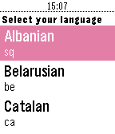

<!-- Generated by scripts/update_app_directory.py: do not edit by hand -->
[← All Pebble Developers](../developers.md)

# betmanenko

*1 app · Last updated 2026-10-12 · [About these lists](../about-app-lists.md)*

Links: [Rebble App Store](https://apps.rebble.io/en_US/developer/561bc3b03493942418000071/1) · [GitHub (betmakh)](https://github.com/betmakh) · [Website (ua.linkedin.com)](https://ua.linkedin.com/in/mykyta-meshcheriakov-603233a2)

<h2 class="app-name" id="app-587a21f6e09e6393ec000854"><a href="https://apps.rebble.io/en_US/application/587a21f6e09e6393ec000854">English Translator</a> v1.0</h2>
<a class="app-source" href="https://github.com/betmakh/pebbleTranslator" title="Source code" data-search-exclude>View source</a>

App

No licence Released 2017-01-14 Updated 2017-01-14 Rebble App Store

Runs on: Time 2, Time

Say word or sentence in English to get translation for your language. Internet connection required. Control: - press &#x27;select&#x27; button and say your word in English - hold &#x27;select&#x27; button to select…

