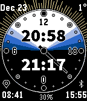

<!-- Generated by scripts/update_app_directory.py: do not edit by hand -->
[← All Pebble Developers](../developers.md)

# Bhakterija

*1 watchface · Last updated 2026-10-12 · [About these lists](../about-app-lists.md)*

Links: [Pebble App Store](https://apps.repebble.com/apps/dev/bhakterija_54d4d034a71307e8ce0000a7) · [GitHub (min2sia)](https://github.com/min2sia)

<h2 class="app-name" id="app-555b08a2c2afa2cc1700008c"><a href="https://apps.repebble.com/555b08a2c2afa2cc1700008c">Solar watch</a> v1.1</h2>
<a class="app-source" href="https://github.com/min2sia/pebble-solar-watch" title="Source code" data-search-exclude>View source</a>

Watchface

Released 2015-05-19 Updated 2017-08-10

Runs on: Time 2, Pebble 2 Duo, Pebble 2, Time, Classic

&quot;If you want to catch a train - look at your watch. If you want to know the best time to work, rest and eat - look at the sun.&quot; This watchface is intended to help you align your daily actitvities…

