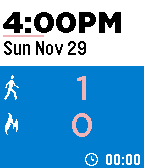

<!-- Generated by scripts/update_app_directory.py: do not edit by hand -->
[← All Pebble Developers](../developers.md)

# BiDuSoft

*1 app · Last updated 2026-10-11 · [About these lists](../about-app-lists.md)*

Links: [Rebble App Store](https://apps.rebble.io/en_US/developer/547fd6328164e16d560000d2/1)

<h2 class="app-name" id="app-54e23ff0cf66dc457400001e"><a href="https://apps.rebble.io/en_US/application/54e23ff0cf66dc457400001e">PlexFit for Pebble</a> v3.2</h2>
<a class="app-source" href="http://bidusoft.blogspot.com/" title="Source code" data-search-exclude>View source</a>

App

Released 2015-02-16 Updated 2015-12-22 Rebble App Store

Runs on: Round 2, Time 2, Pebble 2 Duo, Pebble 2, Time Round, Time, Classic

Why PlexFit ? PlexFit is the most customizable and the most comprehensive fitness tracking solution available today on the Pebble. It has walking, sleeping, running and biking and more. It also…

