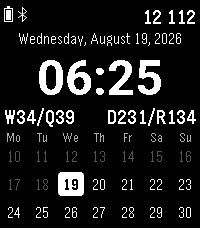

<!-- Generated by scripts/update_app_directory.py: do not edit by hand -->
[← All Pebble Developers](../developers.md)

# Bil Arikan

*1 watchface · Last updated 2026-10-12 · [About these lists](../about-app-lists.md)*

Links: [Pebble App Store](https://apps.repebble.com/apps/dev/bil-arikan_dc67d08e6e7dcd07797a8bd8) · [GitHub (bilarikan)](https://github.com/bilarikan)

<h2 class="app-name" id="app-86b944d8971e4df2a392dfad"><a href="https://apps.repebble.com/86b944d8971e4df2a392dfad">Weekface</a> v1.1.0</h2>
<a class="app-source" href="https://github.com/bilarikan/pebble-watchface-weekface" title="Source code" data-search-exclude>View source</a>

Watchface

MIT Released 2026-08-07 Updated 2026-08-19

Runs on: Time 2

Weekface is a clean, information-dense watchface built around how days, weeks, and quarters structure your year. TOP TO BOTTOM • Status bar : battery, Bluetooth (shown when connected), and today&#x27;s…

