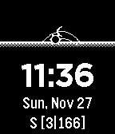

<!-- Generated by scripts/update_app_directory.py: do not edit by hand -->
[← All Pebble Developers](../developers.md)

# Bill Simpson

*1 watchface · Last updated 2026-10-12 · [About these lists](../about-app-lists.md)*

Links: [Pebble App Store](https://apps.repebble.com/apps/dev/bill-simpson_57a2bb641482cdecc700023e) · [GitHub (BillSimpson)](https://github.com/BillSimpson)

<h2 class="app-name" id="app-583e7f5400355abe660008e8"><a href="https://apps.repebble.com/583e7f5400355abe660008e8">Ephemeris</a> v1.1</h2>
<a class="app-source" href="https://github.com/BillSimpson/Ephemeris" title="Source code" data-search-exclude>View source</a>

Watchface

BSD-2-Clause Released 2016-11-30 Updated 2016-12-31

Runs on: Round 2, Time 2, Pebble 2 Duo, Pebble 2, Time Round, Time, Classic

Ephemeris: 1) calculations giving the path of astronomical objects across the sky. 2) a watchface that displays the path of the sun and moon across the sky. Select your location (lat/lon) in…

