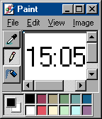
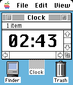
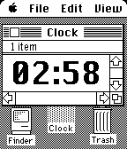

<!-- Generated by scripts/update_app_directory.py: do not edit by hand -->
[← All Pebble Developers](../developers.md)

# bimbodhisattva

*3 watchfaces · Last updated 2026-10-12 · [About these lists](../about-app-lists.md)*

Links: [Rebble App Store](https://apps.rebble.io/en_US/developer/5b6c74294752980001e1a0a8/1) · [GitHub (bimbodhisattva)](https://github.com/bimbodhisattva)

<button type="button" data-filter="all" aria-pressed="true">All 3</button><button type="button" data-filter="watchface" aria-pressed="false">Watchfaces 3</button><button type="button" data-filter="watchapp" aria-pressed="false" disabled>Apps 0</button>

<label class="dev-sort">Sort by <select><option value="updated">Recently updated</option><option value="released">Newest release</option><option value="title">A–Z</option></select></label>

<h2 class="app-name" id="app-67ebcf1c696da700090e5dd4"><a href="https://apps.rebble.io/en_US/application/67ebcf1c696da700090e5dd4">Paint 95</a> v1.1</h2>
<a class="app-source" href="https://github.com/bimbodhisattva/paint-95-for-pebble-time" title="Source code" data-search-exclude>View source</a>

Watchface

No licence Released 2025-04-01 Updated 2025-04-01 Rebble App Store

Runs on: Time 2, Time

For Pebble Time. Based on Windows 95.

<h2 class="app-name" id="app-67dfaf43122b40000904b4fa"><a href="https://apps.rebble.io/en_US/application/67dfaf43122b40000904b4fa">Mac System 7</a> v1.3</h2>
<a class="app-source" href="https://github.com/bimbodhisattva/mac-system-7-for-pebble-time" title="Source code" data-search-exclude>View source</a>

Watchface

No licence Released 2025-03-23 Updated 2025-04-01 Rebble App Store

Runs on: Time 2, Time

For Pebble Time. Displays the current time in iconic Chicago font. Inspired by David Lancaster. Functional updates to come! :)

<h2 class="app-name" id="app-67ebc0028b96250009ecfab7"><a href="https://apps.rebble.io/en_US/application/67ebc0028b96250009ecfab7">Mac System 3</a> v1.0</h2>
<a class="app-source" href="https://github.com/bimbodhisattva/mac-system-3-for-pebble" title="Source code" data-search-exclude>View source</a>

Watchface

No licence Released 2025-04-01 Updated 2025-04-01 Rebble App Store

Runs on: Time 2, Pebble 2 Duo, Pebble 2, Time, Classic

Displays the current time in iconic Chicago font. Inspired by David Lancaster. Functional updates to come! :)

