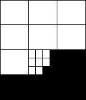

<!-- Generated by scripts/update_app_directory.py: do not edit by hand -->
[← All Pebble Developers](../developers.md)

# binärraum

*1 watchface · Last updated 2026-10-11 · [About these lists](../about-app-lists.md)*

Links: [Pebble App Store](https://apps.repebble.com/apps/dev/bin-rraum_558434f50247ad56ad000040) · [GitHub (binaerraum)](https://github.com/binaerraum)

<h2 class="app-name" id="app-55922b531c5664020300000c"><a href="https://apps.repebble.com/55922b531c5664020300000c">Binary Blocks</a> v1.4</h2>
<a class="app-source" href="https://github.com/binaerraum/Binary-Blocks" title="Source code" data-search-exclude>View source</a>

Watchface

No licence Released 2015-06-30 Updated 2015-07-08

Runs on: Time 2, Pebble 2 Duo, Pebble 2, Time, Classic

Binary Blocks shows the time using 12 blocks for hours and 12 for every 5 minutes. AM time is white on black, PM time is black on white.

