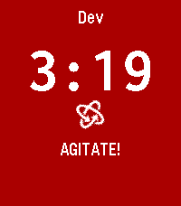

<!-- Generated by scripts/update_app_directory.py: do not edit by hand -->
[← All Pebble Developers](../developers.md)

# BitByBit Whatever

*1 app · Last updated 2026-10-11 · [About these lists](../about-app-lists.md)*

Links: [Pebble App Store](https://apps.repebble.com/apps/dev/bitbybit-whatever_6a77f73f199a1d00081c2af9) · [GitLab (m00dawg)](https://gitlab.com/m00dawg) · [Website (bitbybitphoto.com)](https://www.bitbybitphoto.com)

<h2 class="app-name" id="app-6a7a0321bb2e890009f6b0f8"><a href="https://apps.repebble.com/6a7a0321bb2e890009f6b0f8">Film Devle</a> v1.0.0</h2>
<a class="app-source" href="https://gitlab.com/m00dawg/film-devle" title="Source code" data-search-exclude>View source</a>

App · <a href="https://forum.rebble.io/t/1223" title="Discuss this app on the Rebble forum" data-search-exclude>Forum thread</a>

Released 2026-08-10 Updated 2026-08-10

Runs on: Round 2, Time 2, Pebble 2 Duo, Pebble 2, Time Round, Time, Classic

Black and White photographic film development timer

