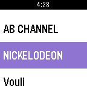

<!-- Generated by scripts/update_app_directory.py: do not edit by hand -->
[← All Pebble Developers](../developers.md)

# bkbilly

*2 apps · Last updated 2026-10-12 · [About these lists](../about-app-lists.md)*

Links: [Pebble App Store](https://apps.repebble.com/apps/dev/bkbilly_56494d724f9b29484c000032) · [GitHub (bkbilly)](https://github.com/bkbilly)

<button type="button" data-filter="all" aria-pressed="true">All 2</button><button type="button" data-filter="watchface" aria-pressed="false" disabled>Watchfaces 0</button><button type="button" data-filter="watchapp" aria-pressed="false">Apps 2</button>

<label class="dev-sort">Sort by <select><option value="updated">Recently updated</option><option value="released">Newest release</option><option value="title">A–Z</option></select></label>

<h2 class="app-name" id="app-56b69f4b114cc5849400004d"><a href="https://apps.repebble.com/56b69f4b114cc5849400004d">Tvheadend-EPG</a> v0.4</h2>
<a class="app-source" href="https://github.com/bkbilly/Tvheadend-EPG" title="Source code" data-search-exclude>View source</a>

App

MIT Released 2016-02-07 Updated 2016-02-07

Runs on: Round 2, Time 2, Pebble 2 Duo, Pebble 2, Time Round, Time, Classic

This uses the Tvheadend that you have installed on your PC, and shows the Program Guide. This is not an official app.

<h2 class="app-name" id="app-568d03658cd1f84a99000068"><a href="https://apps.repebble.com/568d03658cd1f84a99000068">Mopidy-Player</a> v0.9</h2>
<a class="app-source" href="https://github.com/bkbilly/Mopidy-Player" title="Source code" data-search-exclude>View source</a>

App

MIT Released 2016-01-06 Updated 2016-02-07

Runs on: Round 2, Time 2, Pebble 2 Duo, Pebble 2, Time Round, Time, Classic

Mopidy-Player is a remote control for the mopidy service. Control the volume, playback, add songs from your playlist to the queue and remove from songs the queue. Make sure you have access to the…

