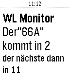

<!-- Generated by scripts/update_app_directory.py: do not edit by hand -->
[← All Pebble Developers](../developers.md)

# BlackDev

*1 app · Last updated 2026-10-11 · [About these lists](../about-app-lists.md)*

Links: [Pebble App Store](https://apps.repebble.com/apps/dev/blackdev_553ba1e97fcaa658d90000d1) · [GitHub (boggyjoe)](https://github.com/boggyjoe) · [Website (wienerlinien.at)](http://www.wienerlinien.at/ogd_realtime/monitor?rbl=1963&sender=rbl)

<h2 class="app-name" id="app-575a87b53d02b16e2c000016"><a href="https://apps.repebble.com/575a87b53d02b16e2c000016">WLmonitor</a> v1.0</h2>
<a class="app-source" href="https://github.com/boggyjoe/PebbleTimeWL_API" title="Source code" data-search-exclude>View source</a>

App

MIT Released 2016-06-10 Updated 2016-06-10

Runs on: Round 2, Time 2, Pebble 2 Duo, Pebble 2, Time Round, Time, Classic

App zeigt die kommenden beiden Abfahrten der Wiener Linien Bus: 66A in der Station Alterlaa Richtung Reumannplatz an. Weitere Entwicklungen kommen.

