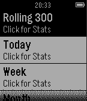

<!-- Generated by scripts/update_app_directory.py: do not edit by hand -->
[← All Pebble Developers](../developers.md)

# blaziken311

*1 app · Last updated 2026-10-12 · [About these lists](../about-app-lists.md)*

Links: [Pebble App Store](https://apps.repebble.com/apps/dev/blaziken311_52f14e89881134fe54000294) · [GitHub (blaziken311)](https://github.com/blaziken311)

<h2 class="app-name" id="app-55cd44f01971947dcd00005c"><a href="https://apps.repebble.com/55cd44f01971947dcd00005c">Tagpro Stats</a> v1.1</h2>
<a class="app-source" href="https://github.com/blaziken311/TP-Stats-Pebble" title="Source code" data-search-exclude>View source</a>

App

No licence Released 2015-08-14 Updated 2015-08-15

Runs on: Time 2, Pebble 2 Duo, Pebble 2, Time, Classic

Access your Tagpro stats from your Pebble watch!

