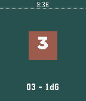

<!-- Generated by scripts/update_app_directory.py: do not edit by hand -->
[← All Pebble Developers](../developers.md)

# Blooper!

*1 app · Last updated 2026-10-11 · [About these lists](../about-app-lists.md)*

Links: [Pebble App Store](https://apps.repebble.com/apps/dev/blooper_57647c273feaeea10e000008) · [GitHub (hdyar)](https://github.com/hdyar)

<h2 class="app-name" id="app-5791726850c752e32e0000e1"><a href="https://apps.repebble.com/5791726850c752e32e0000e1">Dice Roller</a> v1.0</h2>
<a class="app-source" href="https://github.com/hdyar/pebbleDiceRoller/" title="Source code" data-search-exclude>View source</a>

App

Released 2016-07-22 Updated 2016-07-24

Runs on: Round 2, Time 2, Pebble 2 Duo, Pebble 2, Time Round, Time, Classic

A simple dice rolling app. Use the top button to cycle through the number of sides on the dice - 2, 3, 4, 6, 8, 10, or 20. Use the bottom button to cycle through the number of dice. 1 - 6. The…

