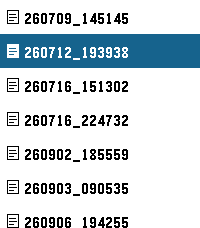
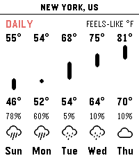
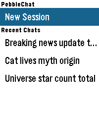
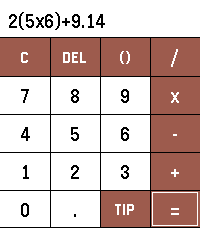

<!-- Generated by scripts/update_app_directory.py: do not edit by hand -->
[← All Pebble Developers](../developers.md)

# bndki

*4 apps · Last updated 2026-10-26 · [About these lists](../about-app-lists.md)*

Links: [Pebble App Store](https://apps.repebble.com/apps/dev/bndki_845ea4e11220c0a802d04a48) · [GitHub (bndki)](https://github.com/bndki)

<button type="button" data-filter="all" aria-pressed="true">All 4</button><button type="button" data-filter="watchface" aria-pressed="false" disabled>Watchfaces 0</button><button type="button" data-filter="watchapp" aria-pressed="false">Apps 4</button>

<label class="dev-sort">Sort by <select><option value="updated">Recently updated</option><option value="released">Newest release</option><option value="title">A–Z</option></select></label>

<h2 class="app-name" id="app-47cd5dc971584935acf4cbbc"><a href="https://apps.repebble.com/47cd5dc971584935acf4cbbc">PebbleNote</a> v1.0</h2>
<a class="app-source" href="https://github.com/bndki/pebble" title="Source code" data-search-exclude>View source</a>

App

GPL-3.0 Released 2026-10-17 Updated 2026-10-17

Runs on: Round 2, Time 2, Pebble 2 Duo, Pebble 2, Time Round, Time, Classic

PebbleNote brings your local text notes directly to your Pebble watch. Powered by a lightweight Android companion server, you can browse folders and read notes offline without any online accounts…

<h2 class="app-name" id="app-b08bdc974fe648d39101c459"><a href="https://apps.repebble.com/b08bdc974fe648d39101c459">PebbleRain</a> v1.7</h2>
<a class="app-source" href="https://github.com/bndki/pebble" title="Source code" data-search-exclude>View source</a>

App

GPL-3.0 Released 2026-09-25 Updated 2026-10-04

Runs on: Round 2, Time 2, Pebble 2 Duo, Pebble 2, Time Round, Time, Classic

PebbleRain brings comprehensive real-time weather forecasts directly to your Pebble watch. Powered by Open-Meteo, you can track local current conditions and extended forecasts without any paid…

<h2 class="app-name" id="app-b3141c68691f4619801cc588"><a href="https://apps.repebble.com/b3141c68691f4619801cc588">PebbleChat</a> v1.3</h2>
<a class="app-source" href="https://github.com/bndki/pebble" title="Source code" data-search-exclude>View source</a>

App

GPL-3.0 Released 2026-09-22 Updated 2026-09-30

Runs on: Round 2, Time 2, Pebble 2 Duo, Pebble 2, Time Round, Time, Classic

PebbleChat brings modern AI language models directly to your Pebble watch. Powered by OpenRouter, you can converse with leading models like Gemini, Claude, and GPT simply by speaking into your…

<h2 class="app-name" id="app-683bdc81238d40c689be0e46"><a href="https://apps.repebble.com/683bdc81238d40c689be0e46">PebbleCalc</a> v1.0</h2>
<a class="app-source" href="https://github.com/bndki/pebble" title="Source code" data-search-exclude>View source</a>

App

GPL-3.0 Released 2026-09-23 Updated 2026-09-23

Runs on: Round 2, Time 2, Pebble 2 Duo, Pebble 2, Time Round, Time, Classic

PebbleCalc brings a simple yet powerful calculator and a smart tip splitter directly to your Pebble watch. [FEATURES] - Full PEMDAS Math Engine: Evaluate standard arithmetic expressions with…

