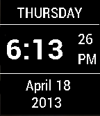
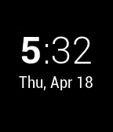

<!-- Generated by scripts/update_app_directory.py: do not edit by hand -->
[← All Pebble Developers](../developers.md)

# Bob Hauck

*3 watchfaces and 1 app · Last updated 2026-10-11 · [About these lists](../about-app-lists.md)*

Links: [Pebble App Store](https://apps.repebble.com/apps/dev/bob-hauck_529e79aa1a6638031c000015) · [GitHub (bobhwasatch)](https://github.com/bobhwasatch)

<button type="button" data-filter="all" aria-pressed="true">All 4</button><button type="button" data-filter="watchface" aria-pressed="false">Watchfaces 3</button><button type="button" data-filter="watchapp" aria-pressed="false">Apps 1</button>

<label class="dev-sort">Sort by <select><option value="updated">Recently updated</option><option value="released">Newest release</option><option value="title">A–Z</option></select></label>

<h2 class="app-name" id="app-52c9cc186e3cc21c54000012"><a href="https://apps.repebble.com/52c9cc186e3cc21c54000012">DigiChron</a> v1.1.1</h2>
<a class="app-source" href="https://github.com/bobhwasatch/digichron" title="Source code" data-search-exclude>View source</a>

App

No licence Released 2014-01-05 Updated 2014-02-21

Runs on: Time 2, Pebble 2 Duo, Pebble 2, Time, Classic

DigiChron is a Pebble app that is intended to operate similarly to a digital watch. It has a main watch face, two countdown timers, and a stopwatch with split and lap times. The source code link…

<h2 class="app-name" id="app-52a39fc6b1da839d06000024"><a href="https://apps.repebble.com/52a39fc6b1da839d06000024">AccuInfo</a> v2.0.1</h2>
<a class="app-source" href="https://github.com/bobhwasatch/accuinfo" title="Source code" data-search-exclude>View source</a>

Watchface

No licence Released 2013-12-07 Updated 2014-02-20

Runs on: Time 2, Pebble 2 Duo, Pebble 2, Time, Classic

For people who want all the time information at once. Can be configured for normal or inverted display. Based on a concept by plumliz.

<h2 class="app-name" id="app-529e829b1a6638cb57000029"><a href="https://apps.repebble.com/529e829b1a6638cb57000029">SimplDay</a> v2.0.1</h2>
<a class="app-source" href="https://github.com/bobhwasatch/simplday.git" title="Source code" data-search-exclude>View source</a>

Watchface

No licence Released 2013-12-04 Updated 2014-02-04

Runs on: Time 2, Pebble 2 Duo, Pebble 2, Time, Classic

Minor modification of the standard Simplicity face to add the day of the week.

<h2 class="app-name" id="app-529e8194d7894b439800000c"><a href="https://apps.repebble.com/529e8194d7894b439800000c">Roboto</a> v2.0.0</h2>
<a class="app-source" href="https://github.com/bobhwasatch/roboto" title="Source code" data-search-exclude>View source</a>

Watchface

No licence Released 2013-12-04 Updated 2013-12-04

Runs on: Time 2, Pebble 2 Duo, Pebble 2, Time, Classic

In the style of the clock from Android 4.2. Orignal concept by cassidyjames.

