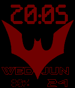
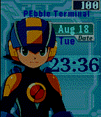
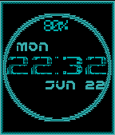

<!-- Generated by scripts/update_app_directory.py: do not edit by hand -->
[← All Pebble Developers](../developers.md)

# BOBdotEXE

*3 watchfaces · Last updated 2026-10-11 · [About these lists](../about-app-lists.md)*

Links: [Pebble App Store](https://apps.repebble.com/apps/dev/bobdotexe_54f5238c89900e4bb10000cf) · [GitHub (BOBdotEXE)](https://github.com/BOBdotEXE) · [Website (blog-dot-exe.blogspot.com)](http://blog-dot-exe.blogspot.com/)

<button type="button" data-filter="all" aria-pressed="true">All 3</button><button type="button" data-filter="watchface" aria-pressed="false">Watchfaces 3</button><button type="button" data-filter="watchapp" aria-pressed="false" disabled>Apps 0</button>

<label class="dev-sort">Sort by <select><option value="updated">Recently updated</option><option value="released">Newest release</option><option value="title">A–Z</option></select></label>

<h2 class="app-name" id="app-558b450bfd0cf8c7c6000027"><a href="https://apps.repebble.com/558b450bfd0cf8c7c6000027">Batman beyond (Batman of the Future)</a> v1.01</h2>
<a class="app-source" href="https://github.com/BOBdotEXE/pebblebeyond/tree/release" title="Source code" data-search-exclude>View source</a>

Watchface

No licence Released 2015-06-25 Updated 2017-08-08

Runs on: Time 2, Pebble 2 Duo, Pebble 2, Time, Classic

The future is under your protection with this new BATMAN BEYOND pebble watchface! every 18 seconds it animates, and has a special surprise at the change of the hour! and in the future (heheh, get…

<h2 class="app-name" id="app-55821fac09d6f4b1ee000034"><a href="https://apps.repebble.com/55821fac09d6f4b1ee000034">Megaman PET</a> v0.48</h2>
<a class="app-source" href="https://github.com/BOBdotEXE/NaviEngine" title="Source code" data-search-exclude>View source</a>

Watchface

GPL-2.0 Released 2015-06-18 Updated 2017-04-28

Runs on: Time 2, Time

Your very own NetNavi! With multiple animations, Blinking, &#x27;jack out&#x27; when you return to the main screen, collapsing clock too! This watch face show the time of day (12hr/24hr format supported) As…

<h2 class="app-name" id="app-5588887b050a7fd8cf000030"><a href="https://apps.repebble.com/5588887b050a7fd8cf000030">CyberPunk Neon dystopia</a> v0.52</h2>
<a class="app-source" href="https://github.com/BOBdotEXE/PebblePunk" title="Source code" data-search-exclude>View source</a>

Watchface

GPL-2.0 Released 2015-06-22 Updated 2017-04-28

Runs on: Time 2, Time

The perfect watch for the dystopian future! Flickering neon, worn text, and visual glitches to change hour and minute! This supports 12 hour time (am/pm) and 24 hour time! and more colors coming…

