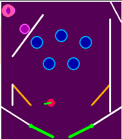

<!-- Generated by scripts/update_app_directory.py: do not edit by hand -->
[← All Pebble Developers](../developers.md)

# Bod9001

*1 app · Last updated 2026-10-11 · [About these lists](../about-app-lists.md)*

Links: [Pebble App Store](https://apps.repebble.com/apps/dev/bod9001_31cbe3b76824204a147878ff) · [GitHub (Bod9001)](https://github.com/Bod9001)

<h2 class="app-name" id="app-0c761d3e7ea44ab1bea5d4dd"><a href="https://apps.repebble.com/0c761d3e7ea44ab1bea5d4dd">Pinball</a> v0.88</h2>
<a class="app-source" href="https://github.com/Bod9001/PebblePinball" title="Source code" data-search-exclude>View source</a>

App

AGPL-3.0 Released 2026-04-12 Updated 2026-04-15

Runs on: Round 2, Time 2

Pinball on your wrist! with the ability to load custom maps via your phone saving on the watch, allowing you to play any time, and allowing the ability for anyone to make maps for the game…

