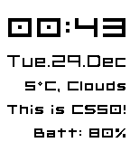

<!-- Generated by scripts/update_app_directory.py: do not edit by hand -->
[← All Pebble Developers](../developers.md)

# Bogdan Orzea

*1 watchface · Last updated 2026-10-12 · [About these lists](../about-app-lists.md)*

Links: [Pebble App Store](https://apps.repebble.com/apps/dev/bogdan-orzea_5482eceb0748a15e57000091) · [GitHub (bogdanorzea)](https://github.com/bogdanorzea)

<h2 class="app-name" id="app-5681b745e08e4838ac00008b"><a href="https://apps.repebble.com/5681b745e08e4838ac00008b">sfclock for Pebble</a> v1.9</h2>
<a class="app-source" href="https://github.com/bogdanorzea/sfclock" title="Source code" data-search-exclude>View source</a>

Watchface

GPL-2.0 Released 2015-12-28 Updated 2016-03-14

Runs on: Time 2, Time

A simple and customisable watchface that supports: - 12-H / 24-H time format; - date display; - weather information from OpenWeatherMap; - custom text display; - battery info; - hourly vibration…

