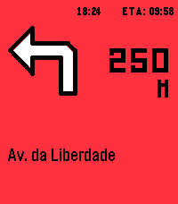

<!-- Generated by scripts/update_app_directory.py: do not edit by hand -->
[← All Pebble Developers](../developers.md)

# bquelhas

*2 apps · Last updated 2026-10-11 · [About these lists](../about-app-lists.md)*

Links: [Rebble App Store](https://apps.rebble.io/en_US/developer/52f2728a881134fe540016b4/1) · [GitHub (bquelhas)](https://github.com/bquelhas)

<button type="button" data-filter="all" aria-pressed="true">All 2</button><button type="button" data-filter="watchface" aria-pressed="false" disabled>Watchfaces 0</button><button type="button" data-filter="watchapp" aria-pressed="false">Apps 2</button>

<label class="dev-sort">Sort by <select><option value="updated">Recently updated</option><option value="released">Newest release</option><option value="title">A–Z</option></select></label>

<h2 class="app-name" id="app-6a4bef0e55030a000a818fc0"><a href="https://apps.rebble.io/en_US/application/6a4bef0e55030a000a818fc0">Steer</a> v1.5.1</h2>
<a class="app-source" href="https://github.com/bquelhas/pebble-steer" title="Source code" data-search-exclude>View source</a>

App · <a href="https://forum.rebble.io/t/1127" title="Discuss this app on the Rebble forum" data-search-exclude>Forum thread</a>

MIT Released 2026-07-06 Updated 2026-07-09 Rebble App Store

Runs on: Round 2, Time 2, Pebble 2 Duo, Pebble 2, Time Round, Time, Classic

STEER mirrors your phone&#x27;s turn-by-turn navigation onto your Pebble: the next maneuver icon, distance, street name and ETA - glanceable on your wrist, so your phone can stay in your pocket. What I…

<h2 class="app-name" id="app-6a2eb7a169dd300009bf84e4"><a href="https://apps.rebble.io/en_US/application/6a2eb7a169dd300009bf84e4">ObsidianTasks</a> v2.2</h2>
<a class="app-source" href="https://github.com/bquelhas/ObsidianTasksPebbleBridge" title="Source code" data-search-exclude>View source</a>

App · <a href="https://forum.rebble.io/t/1067" title="Discuss this app on the Rebble forum" data-search-exclude>Forum thread</a>

MIT Released 2026-06-14 Updated 2026-06-20 Rebble App Store

Runs on: Round 2, Time 2, Pebble 2 Duo, Pebble 2, Time Round, Time, Classic

ObsidianTasks shows your Obsidian to-dos on your Pebble, grouped by tag. From the watch you can: • Mark tasks as done — the change is written straight back to your Markdown vault • Snooze tasks…

