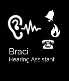
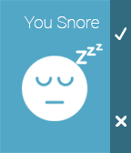

<!-- Generated by scripts/update_app_directory.py: do not edit by hand -->
[← All Pebble Developers](../developers.md)

# Braci Ltd.

*3 apps · Last updated 2026-10-11 · [About these lists](../about-app-lists.md)*

Links: [Rebble App Store](https://apps.rebble.io/en_US/developer/52c1799a01696bf4a7000050/1) · [Pebble App Store](https://apps.repebble.com/apps/dev/braci-ltd_52c1799a01696bf4a7000050) · [Website (braci.co)](http://www.braci.co)

<button type="button" data-filter="all" aria-pressed="true">All 3</button><button type="button" data-filter="watchface" aria-pressed="false" disabled>Watchfaces 0</button><button type="button" data-filter="watchapp" aria-pressed="false">Apps 3</button>

<label class="dev-sort">Sort by <select><option value="updated">Recently updated</option><option value="released">Newest release</option><option value="title">A–Z</option></select></label>

<h2 class="app-name" id="app-53ea37c7114d6ba266000019"><a href="https://apps.rebble.io/en_US/application/53ea37c7114d6ba266000019">Braci - Hearing Assistance</a> v1.6</h2>
<a class="app-source" href="https://play.google.com/store/apps/details?id=com.ugs.braci" title="Source code" data-search-exclude>View source</a>

App

Released 2014-08-12 Updated 2016-08-16 Rebble App Store

Runs on: Time 2, Pebble 2 Duo, Pebble 2, Time, Classic

Braci Ltd. Smart phone application helping deaf and hard hearing people to get alerted in case of emergencies such as : Smoke Alarms , Doorbells , Telephone Ringing and more of situations indoor…

<h2 class="app-name" id="app-542b2906564a6e1366000026"><a href="https://apps.repebble.com/542b2906564a6e1366000026">Braci - Snoring Detector PRO</a> v1.2</h2>
<a class="app-source" href="https://play.google.com/store/apps/details?id=com.ugs.snoring" title="Source code" data-search-exclude>View source</a>

App

Released 2014-09-30 Updated 2015-06-04

Runs on: Time 2, Pebble 2 Duo, Pebble 2, Time, Classic

Description Braci - Snoring Detector App able to detect snoring during night using ( Braci -Snoring Detector App on google store ) using microphone to detect the snore &amp; notify you by short…

<h2 class="app-name" id="app-54a01028bdae6cbfe70000b4"><a href="https://apps.repebble.com/54a01028bdae6cbfe70000b4">Braci - On The Go</a> v1.0</h2>
<a class="app-source" href="https://play.google.com/store/apps/details?id=com.ugs.onthego" title="Source code" data-search-exclude>View source</a>

App

Released 2014-12-28 Updated 2014-12-31

Runs on: Time 2, Pebble 2 Duo, Pebble 2, Time, Classic

Braci – ‘On The Go’ is a unique application that is used by people who are continuously on the go and out &amp; about cycling, driving or just having a walk while listening to music through their…

