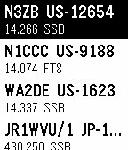

<!-- Generated by scripts/update_app_directory.py: do not edit by hand -->
[← All Pebble Developers](../developers.md)

# Brad Bazemore

*1 app · Last updated 2026-10-12 · [About these lists](../about-app-lists.md)*

Links: [Pebble App Store](https://apps.repebble.com/apps/dev/brad-bazemore_2d642c94cac196c7c7510df0) · [GitHub (sonyccd)](https://github.com/sonyccd)

<h2 class="app-name" id="app-e66883065cae401eb91f6987"><a href="https://apps.repebble.com/e66883065cae401eb91f6987">POTA Pebble</a> v0.0.2</h2>
<a class="app-source" href="https://github.com/sonyccd/pota-pebble" title="Source code" data-search-exclude>View source</a>

App

Released 2026-05-28 Updated 2026-05-29

Runs on: Round 2, Time 2, Pebble 2 Duo, Pebble 2, Time Round, Time, Classic

Shows you the latest POTA spots. You can filter by band and mode.

