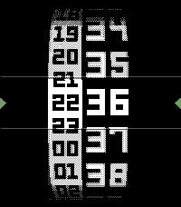

<!-- Generated by scripts/update_app_directory.py: do not edit by hand -->
[← All Pebble Developers](../developers.md)

# Brain in a Bowl

*3 watchfaces · Last updated 2026-10-11 · [About these lists](../about-app-lists.md)*

Links: [Pebble App Store](https://apps.repebble.com/apps/dev/brain-in-a-bowl_56fa41f03f944de56b000023) · [GitHub (Quistnix)](https://github.com/Quistnix) · [Website (braininabowl.com)](http://braininabowl.com/)

<button type="button" data-filter="all" aria-pressed="true">All 3</button><button type="button" data-filter="watchface" aria-pressed="false">Watchfaces 3</button><button type="button" data-filter="watchapp" aria-pressed="false" disabled>Apps 0</button>

<label class="dev-sort">Sort by <select><option value="updated">Recently updated</option><option value="released">Newest release</option><option value="title">A–Z</option></select></label>

<h2 class="app-name" id="app-5a04bbf40dfc323bd0002ff5"><a href="https://apps.repebble.com/5a04bbf40dfc323bd0002ff5">Hobbit Neue</a> v1.0</h2>
<a class="app-source" href="https://github.com/Quistnix/Hobbit_Neue_Open" title="Source code" data-search-exclude>View source</a>

Watchface

No licence Released 2017-11-09 Updated 2017-11-09

Runs on: Round 2, Time 2, Pebble 2 Duo, Pebble 2, Time Round, Time, Classic

I loved the Hobbit Time watchface by Keelan C, but I needed to see the actual Human time as well. So I made this new version with his permission.

<h2 class="app-name" id="app-575c6255b2bc47ab15000021"><a href="https://apps.repebble.com/575c6255b2bc47ab15000021">Rotomotion</a> v2.2</h2>
<a class="app-source" href="https://github.com/Quistnix/Pebble-Rotomotion-Public/" title="Source code" data-search-exclude>View source</a>

Watchface

GPL-3.0 Released 2016-06-11 Updated 2017-01-10

Runs on: Round 2, Time 2, Pebble 2 Duo, Pebble 2, Time Round, Time, Classic

New, improved, prettier and customizable.

<h2 class="app-name" id="app-576123f90c185a4063000030"><a href="https://apps.repebble.com/576123f90c185a4063000030">Nursewatch</a> v1.1</h2>
<a class="app-source" href="https://github.com/Quistnix/Pebble-nurse" title="Source code" data-search-exclude>View source</a>

Watchface

No licence Released 2016-06-15 Updated 2016-06-15

Runs on: Round 2, Time 2, Pebble 2 Duo, Pebble 2, Time Round, Time, Classic

Made on request, with a focus on functionality over looks. Features: - both 24 and 12 hour display - seconds - current date - battery indicator

