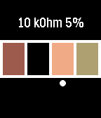

<!-- Generated by scripts/update_app_directory.py: do not edit by hand -->
[← All Pebble Developers](../developers.md)

# Bram Rausch

*1 app · Last updated 2026-10-11 · [About these lists](../about-app-lists.md)*

Links: [Rebble App Store](https://apps.rebble.io/en_US/developer/583c369a00355a8e2700075f/1) · [GitHub (bobbiy)](https://github.com/bobbiy)

<h2 class="app-name" id="app-5855a09206e77674a7000177"><a href="https://apps.rebble.io/en_US/application/5855a09206e77674a7000177">Resistor calculator</a> v2.1</h2>
<a class="app-source" href="https://github.com/bobbiy/Resistors" title="Source code" data-search-exclude>View source</a>

App

No licence Released 2016-12-17 Updated 2017-01-03 Rebble App Store

Runs on: Round 2, Time 2, Time Round, Time

This is an app to help you find the value of a 4-ring resistor.

