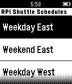

<!-- Generated by scripts/update_app_directory.py: do not edit by hand -->
[← All Pebble Developers](../developers.md)

# Branden Clark

*1 app · Last updated 2026-10-12 · [About these lists](../about-app-lists.md)*

Links: [Pebble App Store](https://apps.repebble.com/apps/dev/branden-clark_54440e55c7733b43f90000e9) · [GitHub (clarkb7)](https://github.com/clarkb7)

<h2 class="app-name" id="app-5491ca9da34dfb129d0000fa"><a href="https://apps.repebble.com/5491ca9da34dfb129d0000fa">RPI Shuttle Schedule</a> v0.5</h2>
<a class="app-source" href="https://github.com/clarkb7/Pebble_RPI_Shuttle_Schedule" title="Source code" data-search-exclude>View source</a>

App

MIT Released 2014-12-17 Updated 2017-02-08

Runs on: Time 2, Pebble 2 Duo, Pebble 2, Time, Classic

View the RPI Shuttle Schedule on your Pebble

