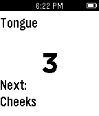

<!-- Generated by scripts/update_app_directory.py: do not edit by hand -->
[← All Pebble Developers](../developers.md)

# Brandon Berookhim

*1 app · Last updated 2026-10-11 · [About these lists](../about-app-lists.md)*

Links: [Pebble App Store](https://apps.repebble.com/apps/dev/brandon-berookhim_53273198cee4fdbba90003cd) · [GitHub (brandonio)](https://github.com/brandonio) · [Website (brandonb.me)](https://www.brandonb.me)

<h2 class="app-name" id="app-54f53b23a8d073ffd7000004"><a href="https://apps.repebble.com/54f53b23a8d073ffd7000004">Toothbrush Buddy</a> v1.0</h2>
<a class="app-source" href="https://github.com/brandonio/toothbrushbuddy" title="Source code" data-search-exclude>View source</a>

App

No licence Released 2015-03-03 Updated 2015-03-03

Runs on: Time 2, Pebble 2 Duo, Pebble 2, Time, Classic

This app should be used as a companion while brushing one&#x27;s teeth. Once started, the app gives the user three seconds to prepare. It then allots 10 seconds per area of the mouth, starting from the…

